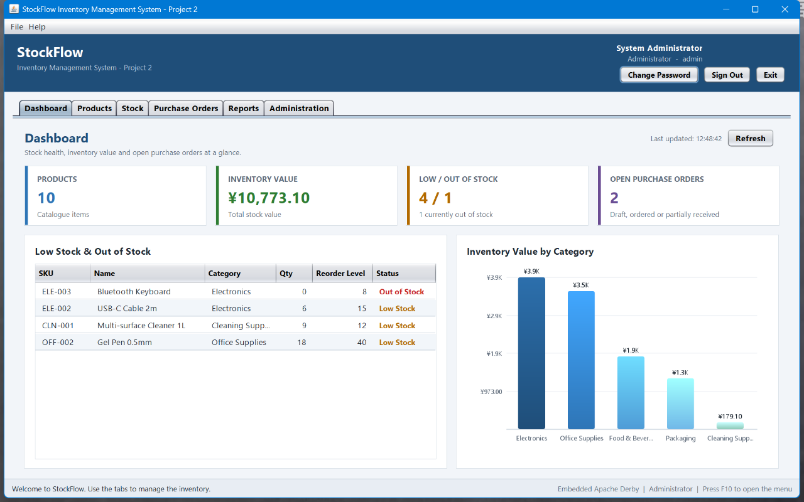
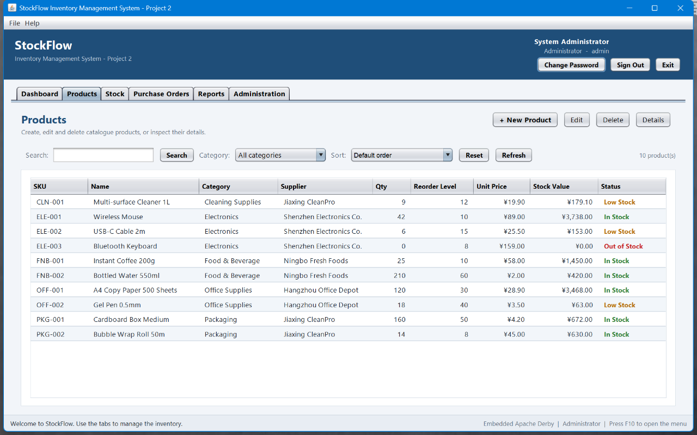
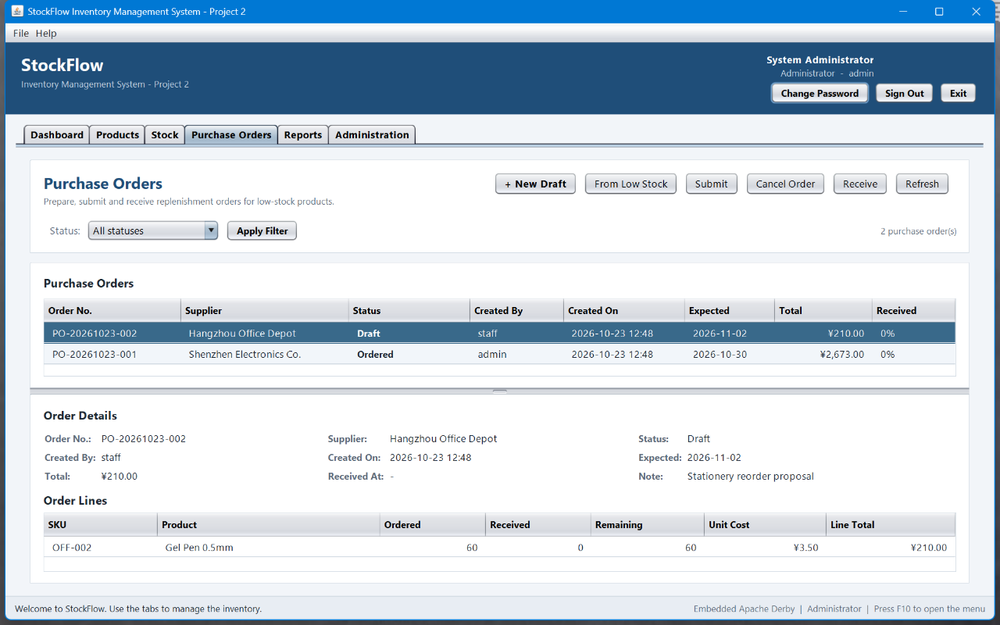
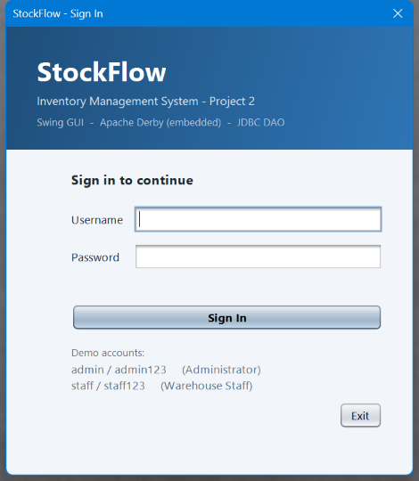

# StockFlow Inventory Management System (Project 2)

A complete Java 17 **Swing GUI** inventory-management application for a small single-warehouse
business, extended from the Project 1 console system. It is backed by an **embedded Apache Derby
database** accessed through a **JDBC DAO layer**, follows an **MVC-style layered architecture** and
is covered by a **JUnit 4 test suite**.

The system needs no manual configuration: the first start creates `data\inventorydb`, creates the
schema and seeds a demonstration dataset. Every later start reconnects to the same database.

| Project 2 requirement | How it is met |
|---|---|
| Java GUI (Swing or JavaFX) | Swing desktop UI with login, dashboard, tabbed workspaces and dialogs |
| Embedded Apache Derby | `org.apache.derby:derby` in embedded mode; database lives under `data\inventorydb` |
| JDBC or Hibernate | Plain JDBC (`PreparedStatement`) through a DAO layer, no ORM needed |
| Data access layer (DAO) | 7 DAO interfaces + 7 `Jdbc*Dao` implementations |
| Meaningful extension of Project 1 | Purchase-order / replenishment workflow (draft, submit, receive, cancel) |
| Design patterns | MVC, DAO, Singleton, Factory, Observer, Strategy, Unit of Work |
| Unit tests | 35 JUnit 4 tests covering DAO operations and business rules |
| Standard Maven project | `mvn clean package` builds a self-contained runnable jar |

---

## 1. Features

| Area | What the system does |
|---|---|
| Sign-in and roles | SHA-256 password hashes in the database; Administrator and Warehouse Staff see different tabs and actions. |
| Dashboard | KPI cards (catalogue size, inventory value, low/out-of-stock, open purchase orders), low-stock table and a hand-drawn category-value bar chart. |
| Product catalogue | Create, edit and delete products (administrator), unique SKU, category, supplier, `BigDecimal` unit price, quantity, reorder level and unit; validated dialogs. |
| Search / filter / sort | Case-insensitive SKU/name search, category filter and sorting by name, quantity or inventory value. |
| Stock movements | Stock-in, stock-out and (administrator) physical-count adjustment; the audit log stores type, signed quantity, unit-price snapshot, operator, timestamp and note. |
| Purchase orders (Project 2 extension) | Draft from selected products or automatically from a supplier's low-stock items, submit, cancel, receive full or partial deliveries; statuses `DRAFT → ORDERED → PARTIALLY_RECEIVED → RECEIVED`, or `CANCELLED`. Receiving creates stock-in transactions atomically. |
| Reports | Inventory valuation, stock movement summary with date range, reorder suggestions with a runtime-selectable policy (threshold or 7-day demand). |
| CSV export | All three reports can be exported to timestamped files under `data\exports\` with a file chooser. |
| Administration | User accounts (create staff, reset password), categories and suppliers with referential-integrity protection; change own password, sign out and exit. |
| Persistence | Embedded Derby auto-created and seeded on first start; all multi-row changes run in one transaction. |
| Error handling | Every expected business error is shown as a friendly dialog; invalid input never crashes the UI. |

---

## 2. Prerequisites

* **JDK 17 or newer** (`java -version`)
* **Apache Maven 3.8 or newer** (`mvn -version`)

Nothing else is required: no database server, no manual schema setup, no external libraries beyond
the Maven dependencies (Derby, JUnit) declared in `pom.xml`.

---

## 3. Build and run

From the `inventory-system` directory:

```bat
mvn clean package
java -jar target\inventory-management-system-2.0.0.jar
```

The shade plugin produces a **self-contained jar** (the embedded Derby driver is included), so the
command above works without any classpath configuration. To start the GUI without a console window,
use `javaw -jar target\inventory-management-system-2.0.0.jar`.

> Run the application from a directory you can write to (the project directory is fine): the
> embedded database is created in `data\inventorydb` relative to the working directory.

---

## 4. Demo accounts and demo data

On the very first start (missing/empty `data\inventorydb`) the application creates the schema and
seeds:

| Account | Password | Role |
|---|---|---|
| `admin` | `admin123` | Administrator (all tabs and actions) |
| `staff` | `staff123` | Warehouse Staff (no administration, no product/stock master-data changes) |

Seeded master data: **5 categories, 4 suppliers, 10 products, 18 historical transactions** and
**2 purchase orders** (one ordered electronics replenishment, one stationery draft). Products
intentionally include low-stock and out-of-stock items (`ELE-002`, `ELE-003`, `OFF-002`, `CLN-001`),
so the dashboard, alerts and purchasing workflow can be demonstrated immediately.

---

## 5. Screen map

```
Sign In
+-- Main Window (tabs depend on role)
    +-- Dashboard             KPI cards / low-stock table / category value chart
    +-- Products              list, search, category filter, sort, add/edit/delete/details
    +-- Stock                 stock in / stock out / adjustment (admin), history, date filter
    +-- Purchase Orders       new draft, from low stock, submit/cancel (admin), receive (full/partial)
    +-- Reports               valuation, movement, reorder suggestions, CSV export
    +-- Administration        users, categories, suppliers (administrator only)
```

Screenshots are in `docs\screenshots\`.

### Dashboard



### Products



### Purchase orders (Project 2 extension)



### Sign-in



---

## 6. Data files and reset

`data\` is created automatically next to the working directory:

| Path | Content |
|---|---|
| `data\inventorydb\` | Embedded Derby database (all tables and data) |
| `data\exports\` | Timestamped CSV exports of the three reports |

**Reset to the demo state**

```powershell
powershell -ExecutionPolicy Bypass -File scripts\reset-data.ps1
```

or simply delete the `data\` directory and start the application again. Derby writes a diagnostic
`derby.log` file to the working directory on shutdown; it is ignored by `.gitignore`.

---

## 7. Architecture

```
ui (MVC)          ui.view.* / ui.view.dialog.*    Swing panels and dialogs (no business logic)
                  ui.controller.*                  action handling, service calls, refresh logic
                  ui.table.* / ui.component.*      table models, KPI cards, charts, renderers
                        |
service           AuthService, ProductService, CatalogService, StockService,
                  ReportService, PurchaseOrderService, TransactionFactory,
                  strategy.* (ReorderPolicy), observer.* (StockLevelObserver)
                        |
dao               UserDao, CategoryDao, SupplierDao, ProductDao,
                  TransactionDao, PurchaseOrderDao, PurchaseOrderLineDao
                  dao.jdbc.*  JDBC implementations on Derby + JdbcSupport
                        |
db / model        DatabaseManager (Singleton, connections + transactions),
                  SchemaInitializer, model.* domain entities
```

* **Layering / MVC** — views never touch DAOs or JDBC; controllers translate UI events into service
  calls and reload the affected view models. Services depend only on DAO interfaces, models and
  `util` helpers, so persistence remains replaceable and unit-testable.
* **DAO** — one interface per aggregate plus JDBC implementations using `PreparedStatement`.
* **Singleton** — `DatabaseManager` owns the single embedded-database configuration and connection
  lifecycle.
* **Factory** — `TransactionFactory` centralises the invariants of stock transactions.
* **Observer** — `StockService` notifies registered `StockLevelObserver`s after every change; the
  GUI observer refreshes the dashboard and shows low/out-of-stock alerts on the EDT.
* **Strategy** — `ReorderPolicy` (`ThresholdReorderPolicy`, `DemandBasedReorderPolicy`) is selected
  at runtime in the reports tab.
* **Unit of Work** — `TransactionRunner` (implemented by `DatabaseManager`) wraps multi-row use
  cases such as receiving a purchase order in one Derby transaction; nested calls join the
  transaction automatically.
* **Composition root** — `app.ApplicationContext` constructs and wires the whole object graph once
  (no service locator, constructor injection everywhere).

### Database schema

| Table | Purpose |
|---|---|
| `users` | accounts, SHA-256 password hashes, role |
| `categories`, `suppliers` | master data referenced by products |
| `products` | SKU, name, category/supplier FK, unit price, quantity, reorder level, unit |
| `stock_transactions` | immutable audit log of stock-in / stock-out / adjustment |
| `purchase_orders` | purchase-order header: number, supplier, status, dates, note |
| `purchase_order_lines` | ordered quantity, unit cost and received quantity per product |

The DDL lives in `src/main/resources/db/schema.sql`.

---

## 8. Tests

Run the JUnit 4 suite with:

```bat
mvn test
```

The suite contains **35 tests** in 8 test classes (plus a shared database-test base class):

| Test class | Tests | Coverage |
|---|---|---|
| `dao.ProductDaoTest` | 5 | product CRUD, SKU lookup, search, category filter, low-stock query |
| `dao.TransactionDaoTest` | 3 | transaction persistence, date-range query (from inclusive / to exclusive), recent ordering |
| `dao.PurchaseOrderDaoTest` | 4 | order + line round-trip, order-number sequence, status filter, line deletion |
| `service.AuthServiceTest` | 5 | sign-in success/failure, hashed passwords, role checks |
| `service.StockServiceTest` | 6 | stock-in/out, insufficient-stock rejection, adjustment, observer notifications |
| `service.PurchaseOrderServiceTest` | 6 | draft validation, submit/cancel rules, partial and full receiving, stock + audit updates |
| `service.ProductCatalogServiceTest` | 4 | product creation/filtering, duplicate SKU, delete protection |
| `service.ReportServiceTest` | 2 | valuation totals, movement aggregation |

Each test runs against an isolated embedded Derby in-memory database, so the suite is repeatable
and leaves no files behind. See `docs\TEST_EVIDENCE.md` for the recorded run.

A one-command verification (build + tests + runnable jar) is available as:

```powershell
powershell -ExecutionPolicy Bypass -File scripts\verify.ps1
```

---

## 9. Report support materials

The Project 2 report uses the following deliverables (all derived from the built code):

| Item | Files | Description |
|---|---|---|
| Design figures | `docs\design\figure1_use_case_p2.png`, `figure2_class_diagram_p2.png`, `figure3_er_diagram_p2.png`, `figure4_mvc_architecture_p2.png` | Use-case diagram, final class diagram, Derby ER diagram and MVC/layered architecture, all print-ready at 6.3 in width (every label >= 7.5 pt) |
| Figure guide | `docs\design\README.md` | Figure inventory, suggested captions, report placement and the design-evolution paragraph |
| Figure generator | `docs\design\generate_design_diagrams.py` + `pillow_uml.py` | Pillow-only, reproducible generator (no Graphviz/PlantUML); re-run with the bundled Python |
| Figures in Word | `docs\P2_Design_Figures.docx` | The four figures with captions and placement notes, one figure per page |
| AI usage log | `docs\AI_USAGE_LOG.md` and `docs\AI_Usage_Log.docx` | Report Appendix A draft: tools used, 14-row prompt log, human-vs-AI contribution table and declaration |
| Build scripts | `scripts\build_design_figures_docx.py`, `scripts\build_ai_usage_log_docx.py` | Regenerate the two Word documents from the PNG/Markdown sources |

The AI usage log is a draft that the author must review, confirm and edit before submission; the
critical reflections stay student-authored as required by the assessment.

---

## 10. Project structure

```
inventory-system/
+-- pom.xml                          Maven build (Java 17, Derby, JUnit 4, shade plugin)
+-- README.md
+-- .gitignore                       target/, data/, derby.log, IDE files
+-- docs/
|   +-- TEST_EVIDENCE.md             build/test evidence for Project 2
|   +-- screenshots/                 captured GUI screenshots
|   +-- design/                      four report figures + Pillow generator + figure guide
|   +-- AI_USAGE_LOG.md              report Appendix A (Markdown source)
|   +-- AI_Usage_Log.docx            report Appendix A (formatted Word draft)
|   +-- P2_Design_Figures.docx       figures with captions, one per page
+-- scripts/
|   +-- verify.ps1                   build + JUnit suite + runnable-jar check
|   +-- reset-data.ps1               deletes data\ so the demo seed is recreated
|   +-- build_design_figures_docx.py regenerates docs\P2_Design_Figures.docx
|   +-- build_ai_usage_log_docx.py   regenerates docs\AI_Usage_Log.docx
+-- src/main/resources/db/schema.sql Derby DDL executed on first start
+-- src/main/java/com/cjlu/inventory/
|   +-- App.java                     entry point (look and feel, login, main window)
|   +-- app/                         ApplicationContext (composition root), DataSeeder
|   +-- db/                          DatabaseManager (Singleton), SchemaInitializer
|   +-- dao/  dao/jdbc/              DAO interfaces + JDBC implementations
|   +-- model/                       domain entities incl. purchase orders
|   +-- service/                     business services, Factory, Strategy, Observer
|   +-- ui/                          Swing MVC GUI (controller, view, table, component, util)
|   +-- util/                        Validator, PasswordHasher, CsvUtils
+-- src/test/java/com/cjlu/inventory/
    +-- support/                     AbstractDatabaseTest (isolated in-memory Derby fixtures)
    +-- dao/ service/                JUnit 4 test classes
```

Code size: **103 Java source files / ~9,500 lines** in `src/main/java` and **9 test files /
~1,100 lines** in `src/test/java`.

---

## 11. Troubleshooting

| Symptom | Cause / solution |
|---|---|
| `mvn` is not recognised | Add Maven's `bin` directory to `PATH`, or use an IDE's bundled Maven. |
| `invalid target release: 17` | The active JDK is older than 17. Switch `JAVA_HOME` to JDK 17+. |
| `Invalid username or password.` | Use the demo accounts above. If `users` data was changed, reset `data\` to reseed. |
| Database appears locked | Another running instance still holds `data\inventorydb`. Close it; Derby allows one embedded process at a time. |
| Demo data does not appear | The database already contains data (seeding is first-run only). Delete `data\` to reseed. |
| Exported reports are missing | Look in `data\exports\`; the GUI shows the absolute path after export. |
| Window looks different | Run with a real desktop session (not headless); `java -jar` also works but keeps a console window open. |
| Need to reset everything | Close the application, then run `scripts\reset-data.ps1` and start again. |

---

## 12. Scope note

This is the **Project 2** deliverable: the same inventory topic as Project 1, extended with a Swing
GUI, an embedded Derby database, a JDBC DAO layer, MVC-style layering, meaningful unit tests and a
new purchase-order / replenishment workflow. Version-control history and the demonstration video
are prepared separately from the source tree.
